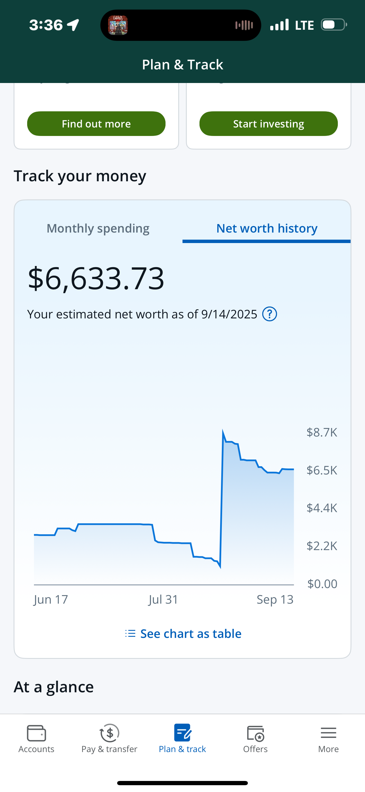
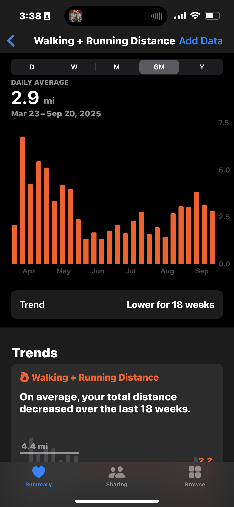
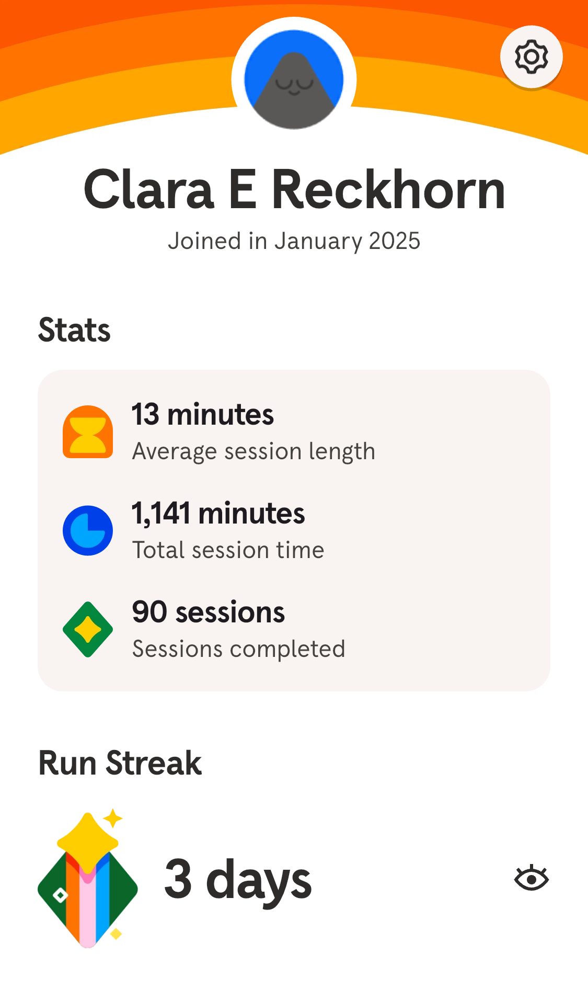
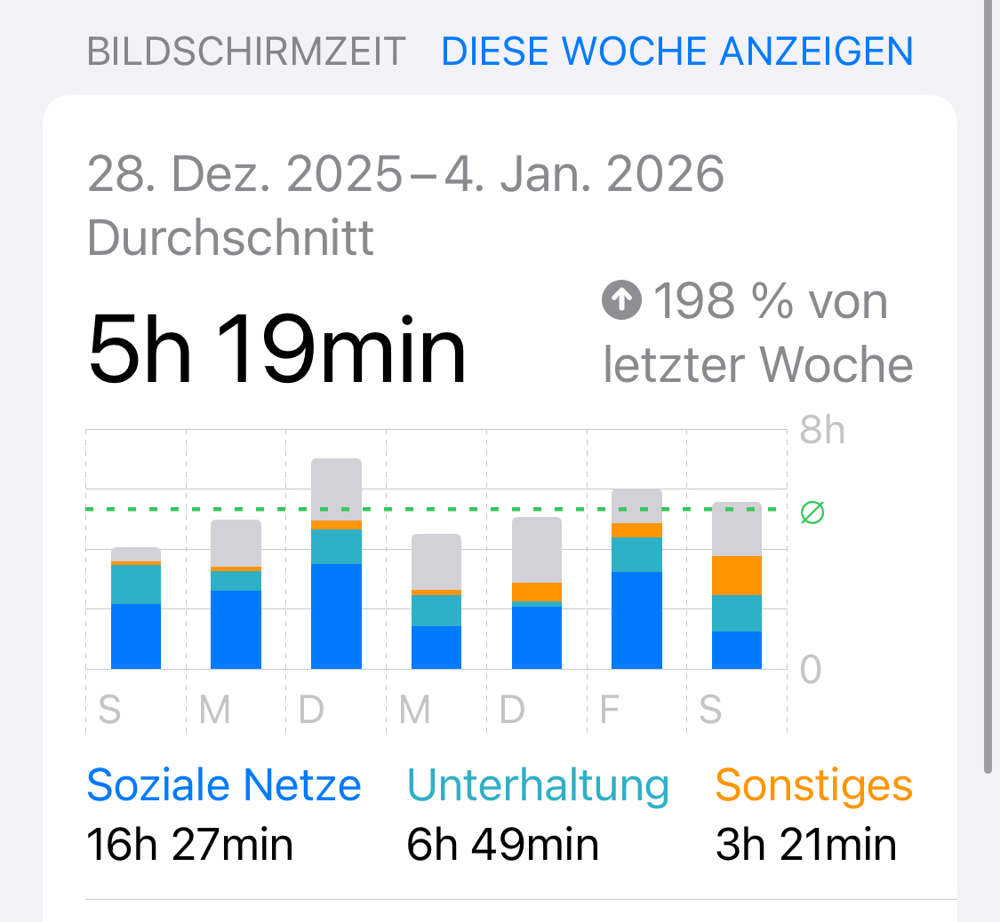
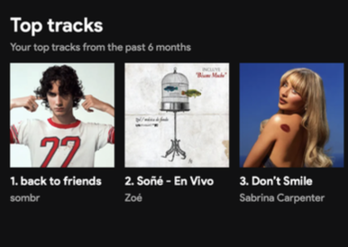
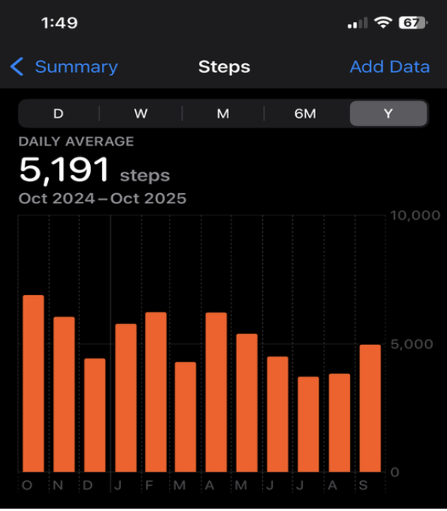
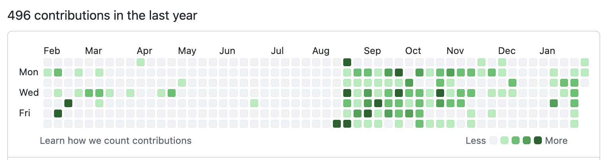
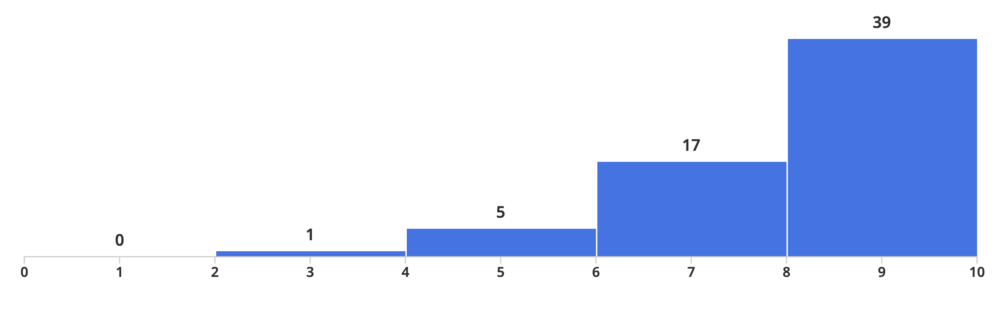
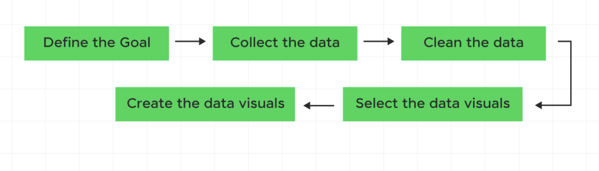

# Welcome!

# About Us

## Montse 
::: {.nonincremental}

- Sophomore Stats Major
- Hometown: Mexicali, Baja California + Calexico, California
- Fun fact: I have a dog named Shakira! 
- Course reader for Stat133, Stat 33B, now tutor for Stat133
:::

::: {.callout-note}
Email me at montserrat_ibarra@berkeley.edu
:::


## Clara 
::: {.nonincremental}

- Senior Stats Major
- Hometown: Palos Verdes, CA + Osnabrück, Germany
- Fun fact: Pursuing masters in Europe!
- GSI for Stat133 + led HelloWorld
- Transfer student

::: {.callout-note}
Email me at clara_reckhorn@berkeley.edu
:::
:::

## Jocelyne 
::: {.nonincremental}

- Senior Stats Major
- Hometown: San Mateo, CA
- Fun fact: I did middle and high school in La Paz, Mexico!
- Course reader for Stat133
- Transfer student 

::: {.callout-note}
Email me at jocelyneperez@berkeley.edu
:::

:::

# Personal Data Viz

## Montse

::: {.columns}
::: {.column width="33%"}
{width=100%}
:::

::: {.column width="33%"}
{width=100%}
:::
:::
## Clara 

::: {.columns}
::: {.column width="33%"}
{width=100%}
:::

::: {.column width="33%"}
{width=100%}
:::
:::

## Jocelyne 

::: {.nonincremental}

::: {.columns}

::: {.column width="33%"}
{width=100%}
:::

::: {.column width="33%"}
{width=100%}
:::
:::

:::

## Some of our favorite Data Visualizations

::: {.nonincremental}
- [Gun Deaths Viz](https://guns.periscopic.com/) \
- [Wind Map Viz](http://hint.fm/wind/) \
- [En-ROADS Temperature Increase Dashboard](https://en-roads.climateinteractive.org/scenario.html?v=26.1.0)
:::

### There is data all around us if you know where to look!


## Surrounded by graphics {.smaller}

::: {.columns}

::: {.column width="50%"}
- This has not always been the case
- Our parent's generation had no immediate access to graphics
- Graphics we can easily get access to:
  - Credit score (donut chart/timeline)
  - Number of commits to a GH repo (tiles graph)
  - Score distribution of an exam (histogram)
  - ETC
:::

::: {.column width="50%"}


:::

:::


# Visual Literacy
- Nowadays: very easy to access graphical displays of any kind of data
- Consumers of data viz
- We lack formal education in visual literacy 
- This course: a solid foundation in visual literacy involving both the consumption and production of graphics

# Why are we teaching this class?
- Brainchild of Prof. Sanchez (Statistics Faculty Member) who is passionate about all things data viz
- Stats dept has no dedicated data viz course, so Prof Sanchez decided to put together materials for 1 semester course
- Offered: Fall 2023, Spring 2024, Fall 2024... restructured for this semester!

# Your introductions

## Activity: Introduce yourself! {.smaller}

::: {.nonincremental}
Before course logistics, we would like to get to know a bit about you. \

- Grab a "Hello My Name Is" sticker from the front table

### Tell us: 
- Your name
- Your major/area of study
- Why are you taking this class?
- Your favorite data vizualization (if you have one!) or the last graphic you saw in the last week 


:::

## Activity: Two truths and a lie

::: {.nonincremental}
- Think of two truths and one lie about yourself 
- Share with a partner and have them guess which one is the lie


:::


# What is DataViz? 
- The graphical representation of information and data
- The goal is to communicate information clearly and effectively through graphical means
- Good visualization helps users analyze and reason about data and evidence
- Makes complex data more accessible, understandable, and usable

## What is the typical DataViz process? {.smaller}


# Let's try out this process! (You are the subjects)

## 1. Define the goal
### Want to find out: 
What factors influence the amount of sleep a Berkeley student gets on weekdays?

## 2. Collect the Data

::: {.nonincremental}
- On a piece of paper:\
  - Average amount of sleep on weekdays (Number) \
  - Transfer T/F \
  - Grad student T/F \
  - Commute to campus (in minutes) \
  - Favorite drink (water, tea, coffee, etc) \
  - Major \
  - Number of enrolled units you are taking \


:::

## 3. Data Cleaning
Assume our data is cleaned and ready to go... we will save the actual data cleaning for later units!

```{r}
#| output-location: column-fragment
library(tidyverse)

# toy dataset
sleep_data <- tibble(
  student_id = 1:10,
  sleep_hours = c(6.5, 7, 5.5, 8, 6, 7.5, 6, 5, 8.5, 7),
  transfer = c(TRUE, FALSE, TRUE, FALSE, FALSE, TRUE, FALSE, TRUE, FALSE, FALSE),
  grad_student = c(FALSE, FALSE, FALSE, FALSE, TRUE, FALSE, FALSE, FALSE, TRUE, FALSE),
  commute_min = c(45, 10, 60, 15, 20, 50, 5, 70, 25, 30),
  favorite_drink = c("Coffee", "Water", "Coffee", "Tea", "Tea",
                     "Coffee", "Water", "Coffee", "Tea", "Water"),
  major = c("Econ", "Stats", "CS", "Psych", "Public Health",
            "Econ", "Stats", "CS", "Bio", "Psych"),
  units = c(16, 13, 18, 14, 12, 17, 15, 19, 11, 16)
)
```

## 3. Data Cleaning
That code will result in:

```{r}
sleep_data
```

## 4. Select the data visuals

::: {.nonincremental}
- In a group (3-4 people):
  - Brainstorm how you could visualize a primary (hours of sleep) vs secondary variables (transfer, drink, major, commute, units)
  - Choose a chart type, e.g. Bar chart, Pie chart, Scatter plot, Line graph, etc.
  - How could you combine all variables (or at least three) in one graph?


:::

## 5. Create the data visuals

::: {.nonincremental}
- On a poster: \
  - Make 4 graphs to visualize your thoughts on these categories \
  - One should use 3 of the variables in one graph


:::

## Some example graphs

```{r}
# graph 1 - sleep vs commute time (scatter plot with regression line)
graph1 <- ggplot(sleep_data, aes(x = commute_min, y = sleep_hours)) +
  geom_point(size = 3) +
  geom_smooth(method = "lm", se = FALSE) +
  labs(
    title = "Sleep vs Commute Time",
    x = "Commute Time (minutes)",
    y = "Average Weekday Sleep (hours)"
  ) +
  theme_minimal()

# graph 2 - sleep vs favorite drink (bar chart)
graph2 <- sleep_data %>%
  group_by(favorite_drink) %>%
  summarise(avg_sleep = mean(sleep_hours)) %>%
  ggplot(aes(x = favorite_drink, y = avg_sleep)) +
  geom_col() +
  labs(
    title = "Average Sleep by Favorite Drink",
    x = "Favorite Drink",
    y = "Average Sleep (hours)"
  ) +
  theme_minimal()

# graph 3 - sleep vs units (scatter plot colored by transfer status)
graph3 <- ggplot(sleep_data, aes(x = units, y = sleep_hours, color = transfer)) +
  geom_point(size = 3) +
  labs(
    title = "Sleep vs Units by Transfer Status",
    x = "Units Enrolled",
    y = "Average Weekday Sleep (hours)",
    color = "Transfer Student"
  ) +
  theme_minimal()

# graph 4 - sleep vs major (boxplot colored by grad student status)
graph4 <- ggplot(sleep_data, aes(x = major, y = sleep_hours, fill = grad_student)) +
  geom_boxplot() +
  labs(
    title = "Distribution of Sleep Hours by Major",
    x = "Major",
    y = "Average Weekday Sleep (hours)",
    fill = "Grad Student"
  ) +
  theme_minimal() +
  theme(axis.text.x = element_text(angle = 45, hjust = 1))
```

## Some example graphs (cont'd) {.smaller}
```{r}
# Print the graphs
graph1
```

## Some example graphs (cont'd) {.smaller}
```{r}
# Print the graphs
graph2
```

## Some example graphs (cont'd) {.smaller}
```{r}
# Print the graphs
graph3
```

## Some example graphs (cont'd) {.smaller}
```{r}
# Print the graphs
graph4
```


# Course Logistics

::: {.nonincremental}
- Syllabus overview
- Grading + Attendance policy 
- Course structure
- Required software (RStudio/Positron and R)

[Berkeley DataHub](https://r.datahub.berkeley.edu)

:::


## Install R and RStudio
and subscribe to NYT!


## Attendance 
On a piece of paper, please write your name and answer the following: \
- One thing you are excited to learn in this course \
- One thing you are nervous about in this course \
- If you have any questions, feel free to ask them here

### Thank you!

