# Learning Goals

::: nonincremental
-   Understand different types of variables and how they influence chart selection.
-   Understand how different purposes or analytical tasks influence chart selection
-   Understand the theoretical framework of the Grammar of Graphics
-   Break down key components of a graphic: data, aesthetics, geoms, stats, scales, facets, themes
-   Learn how ggplot2 implements this grammar in practice
:::

# Discussion {.smaller}

**Reading:** [The Age That Women Have Babies](https://www.nytimes.com/interactive/2018/08/04/upshot/up-birth-age-gap.html)

Get into groups of 2-3 people and discuss the following questions:

::::: {columns}
::: {.column width="40%"}
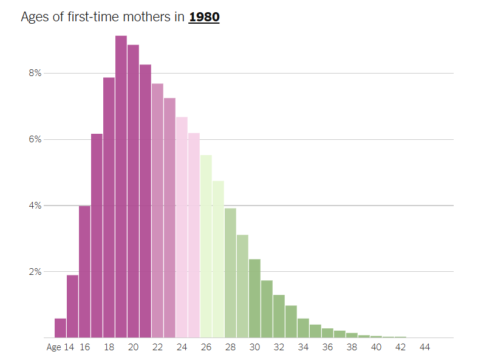
:::

::: {.column width="40%"}
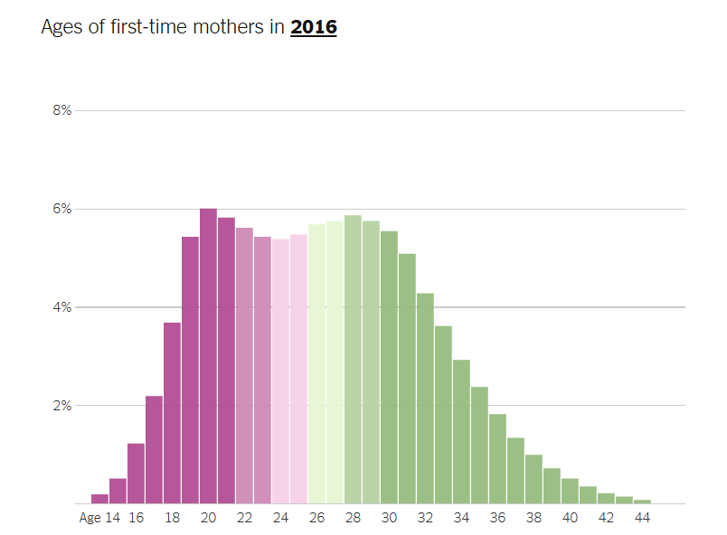
:::
:::::

1.  What is something you like about the way this data is portrayed?
2.  What is something you would change in these visualizations?
3.  What data does the percentages on the vertical axis represent?

# Classification of Variables

. . .

A **variable** is a data item that can vary or change, and it can take on different values.

There are two types of scales a variable could be:

-   Categorical Variable

-   Quantitative Variable

## Categorical

Type of variable that **represents categories** or groups. It takes one of a limited, usually fixed, number of possible values, assigning each unit of observation to a particular group or nominal category on the basis of some qualitative property.

### Examples:

-   [Binary]{.underline}: Only **takes two** possible values, and are typically represented as 1 or 0.

-   [Nominal]{.underline}: Categories have **no clear** **order**, and are mutually exclusive

-   [Ordinal]{.underline}: Have a **clear ordering** of the categories

## Quantitative

Numerical data point (AKA numerical variable) that can be *measured* or *counted*, allowing for mathematical operations to be applied.

### Examples:

-   [Discrete]{.underline}: Can take any **countable** value represented as an integer (whole number),

-   [Continuous]{.underline}: Can take any **measurable** value within a given range, including fractions and decimals.

# Chart Selection

While the grammar of graphics is an excellent tool that lets us specify and construct a visual display of data, it does not tell us what graphic to use.

## Right Graph for the Right Analytical Task {.smaller}

| Purpose | Example Chart Types |
|------------------------------------|------------------------------------|
| Change over time | Timeline (line chart), area chart, slope chart |
| Showing part-to-whole | Stacked bar, donut chart, treemap |
| Comparisons | Bar chart , column chart, dot plot |
| Distributions (quantitative variable) | Histogram, boxplot, violin plot, density |
| Ranking | Bar chart (sorted), lollipop chart |
| Relationships | Scatter plot, bubble chart, connected scatter |
| Correlations | Scatter plot, matrix chart |
| Geospatial | Choropleth, symbol map |
| Flow | Arrow charts, Sankey diagram |
| Text | Word cloud |

: Stephen Few: analytical tasks or analytical patterns

# Activity 1: Variables and Graphs

. . .

For each graph, identify the type of variables used (i.e. quantitative or categorical), and the analytical task that can be done with such graph.

## Lollipop Chart

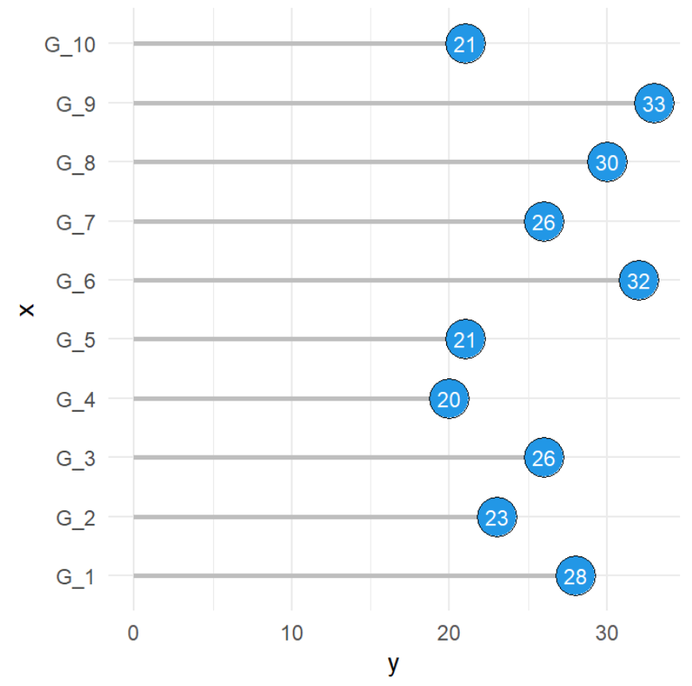

## Sorted Bar Chart

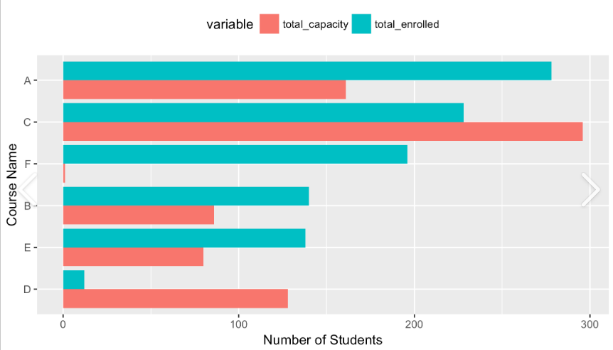

## Donut Chart

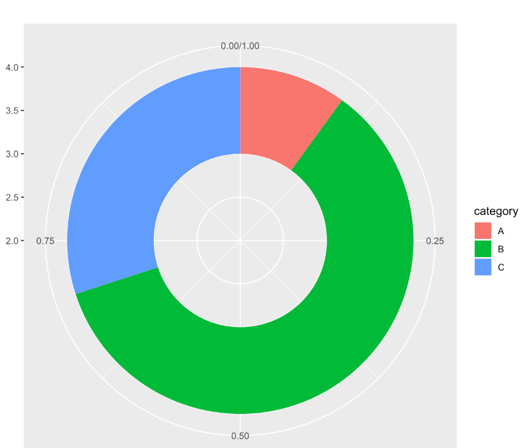

## Sankey Diagram

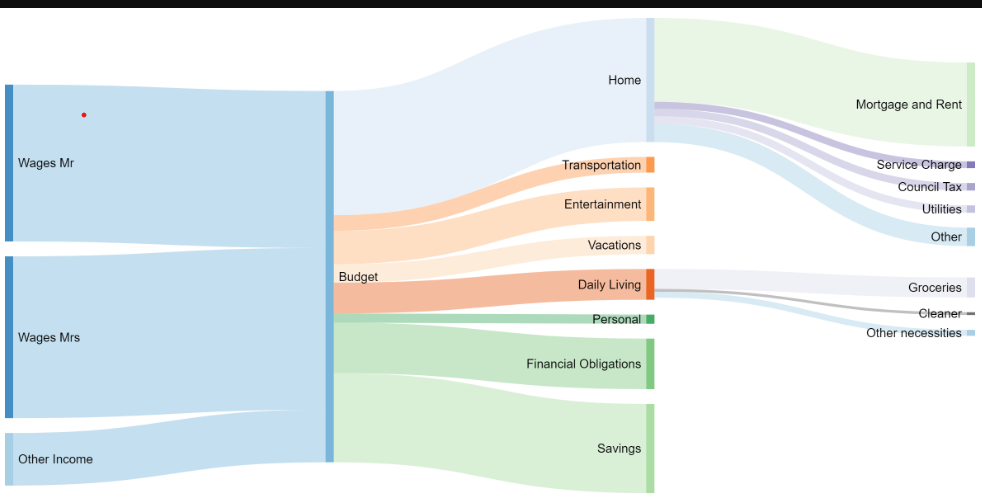

# The Grammar of Graphics

## "The Grammar of Graphics"

From a conceptual perspective, making graphics involves **mapping data** to *geometric objects* and their *visual properties*.

## Why do we need Grammar of Graphics (GG)?

. . .

We believe that the GG is a good starting point that gives us a **framework** (mental map) and a **vocabulary** to create graphics.

This grammar allows creation of graphics to be:

-   consistent

-   reusable

-   modular

## 

Formalized by Leland Wilkinson (1999)

::::: columns
::: {.column width="30%"}
-   A formal set of rules to create any type of graphics
-   Underlies most modern data visualization software.
-   Implemented as an R package ('ggplot2')
:::

::: {.column width="70%"}
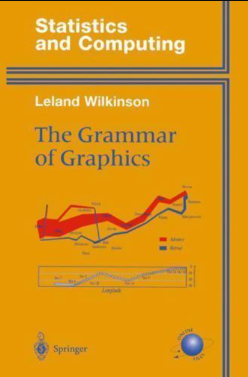
:::
:::::

## Key Concepts {.smaller}

::::: columns
::: {.column width="60%"}
-   **Data**: the data set being visualized (next week!)
-   **Aesthetics (aes)**: how variables map to visual properties (x, y, color, size, etc)
-   **Geometric objects (geoms)**: what kind of marks to draw (points, bars, lines)
-   **Facets**: creating small multiples by splitting data into panels
-   **Stats**: statistical transformations (e.g. binning for histograms, smoothing lines)
-   **Coordinates**: how data values are translated into visual values (e.g. color gradients)
-   **Themes**: controlling non-data elements (fonts, backgrounds, gridlines)
:::

::: {.column width="40%"}
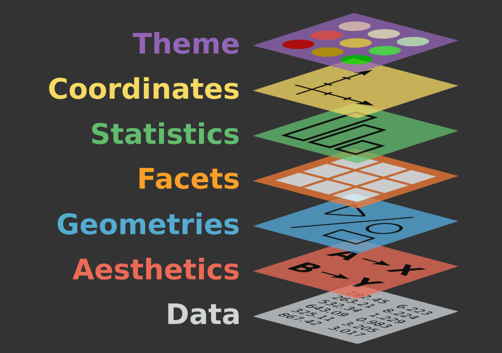
:::
:::::

## Aesthetic Mapping {auto-animate="true"}

. . .

An *aesthetic mapping* links a [variable]{.underline} in the data to a [visual channel]{.underline} that can encode its variation.

. . .

### Channels for ordered variables

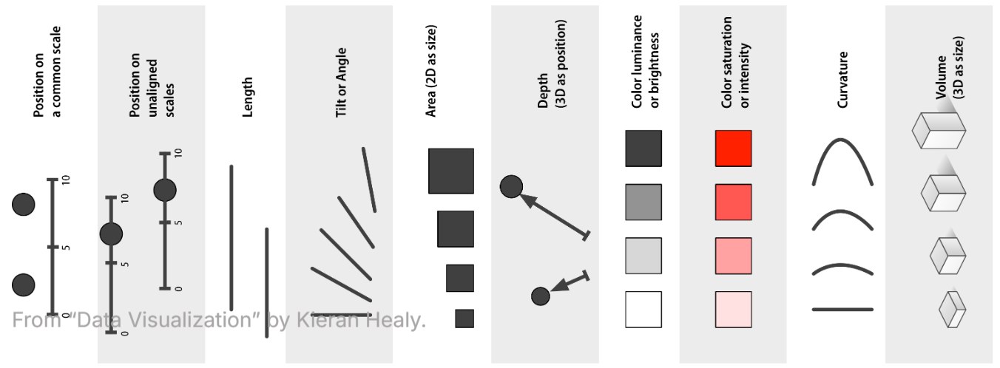

::: aside
From "Data Visualization" by Kieran Healy.
:::

## 

. . .

### Channels for unordered variables

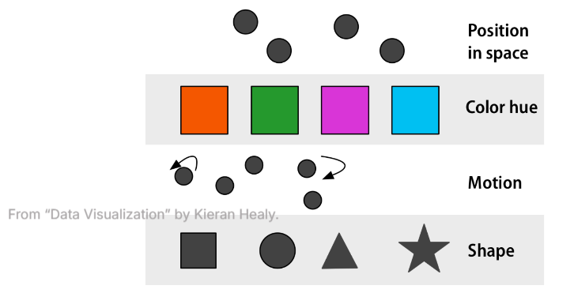{fig-align="center"}

::: aside
From "Data Visualization" by Kieran Healy.
:::

## Geometry

The *geometry* describes how to translate the observations into marks on the page.

. . .

### Examples

-   Point
-   Line
-   Bar

# Activity 2: Incorrect or Correct use of GG

. . .

Explain why the following graphs do not implement grammar of graphics correctly.

## 

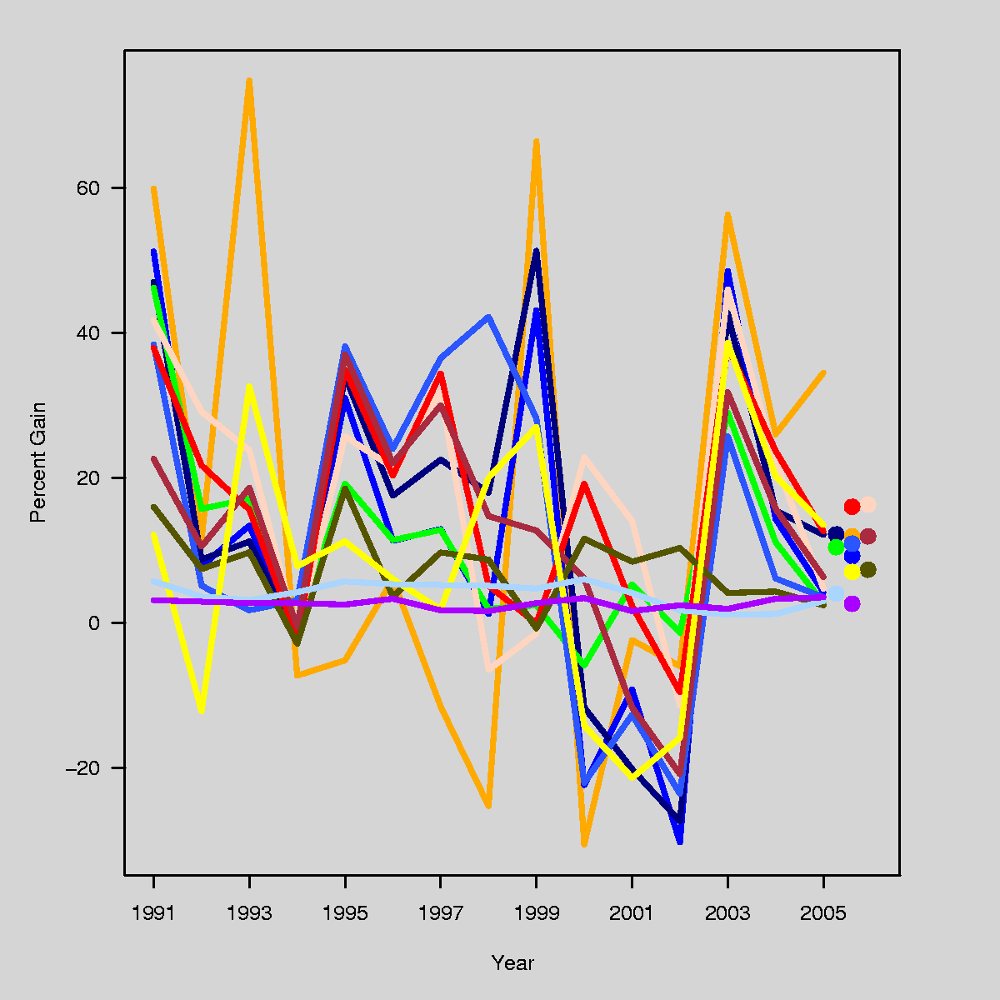

## 

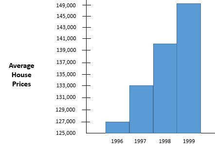

# ggplot2

##  {auto-animate="true"}

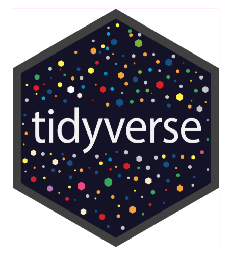{fig-align="center"}

##  {auto-animate="true"}

::::: columns
::: {.column width="50%"}

:::

::: {.column width="50%"}

:::
:::::

##  {auto-animate="true"}

:::::: columns
::: {.column width="33%"}
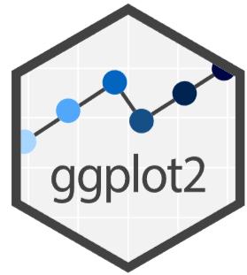
:::

::: {.column width="33%"}

:::

::: {.column width="33%"}

:::
::::::

## `ggplot2()`

. . .

A plot can be decomposed into three primary elements:

1.  the **data**,
2.  the **aesthetic mapping** of the variables in the data to visual channels, and
3.  the **geometry** used to translate the observations into marks on the plot.

# Code Example

Here’s an example of code and output using **ggplot2** in R.

```{r}
#| output-location: column-fragment
library(ggplot2)

ggplot(mtcars, aes(x = wt, y = mpg, color = factor(cyl))) +
  geom_point(size = 3) +
  geom_smooth(method = "lm", se = FALSE) +
  theme_minimal() +
  labs(
    title = "Miles per Gallon vs. Weight",
    color = "Cylinders"
  )
```

##  {.smaller}

## Meet the Palmer Penguins

```{r}
library(palmerpenguins)
penguins
```

## 

**Question**: In terms of the way they are constructed...

```{r}
#| echo: false
#| fig-width: 16
#| fig-align: center
library(tidyverse)
library(ggplot2)
library(palmerpenguins)

p1 <- penguins |>
  ggplot(aes(x = bill_length_mm)) +
  geom_histogram() +
  theme_bw(base_size = 15)

p2 <- penguins |>
  ggplot(aes(x = bill_depth_mm)) +
  geom_density() +
  theme_bw(base_size = 15)

p3 <- penguins |>
  ggplot(aes(x = body_mass_g)) +
  geom_boxplot() +
  theme_bw(base_size = 15)

library(patchwork)

p1 + p2 + p3
```

What do these plots have in common? How do they differ?



## 

**Question**: What do these plots have in common? How do they differ?

```{r}
#| echo: false

p4 <- penguins |>
  ggplot(aes(x = island,
             fill = species)) +
  geom_bar(position = "fill")

p5 <- penguins |>
  ggplot(aes(y = sex)) +
  geom_bar()

p4 + p5
```



## 

**Question**: What are the aesthetic mappings and geometries used here?

```{r}
#| echo: false
#| fig-align: center
penguins |>
  ggplot(aes(x = bill_length_mm,
             y = flipper_length_mm,
             color = species,
             shape = sex)) +
  geom_point() +
  theme_gray(base_size = 18)
```



# Wrap up

## Summary

This is the process of how data is encoded to a visual through the framework that grammar of graphics offers.

## Attendance Worksheet

Make sure to turn in your worksheet before leaving with your name on it please!!

## Homework

Read [The Persistent Grip of Social Class on College Admissions](https://www.nytimes.com/2021/05/26/upshot/college-admissions-essay-sat.html)

